

 

## 👋 About me

Hi, I'm Alyssa! I'm a **Computer Science graduate from New Era University (Class of 2026)** and an aspiring data analyst. I enjoy cleaning data, exploring patterns, and turning findings into clear, actionable insights. I'm always learning new tools and building projects to strengthen my analytical skills.

 

## 🧰 Tech stack

**Languages**

**Data Analytics & Machine Learning**

**Databases**

**Web Development**

**Tools**

 

## 🏅 Certifications

<table>
<tr>
<td align="center" valign="top">
<a href="https://courses.cognitiveclass.ai/certificates/e830430773954519848a27b0622151b9">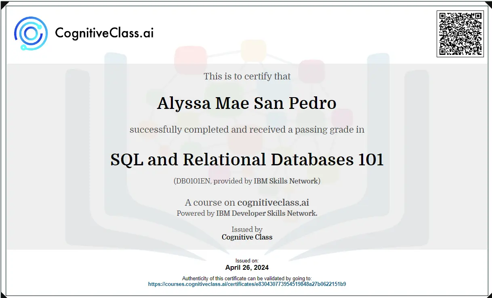</a> 
SQL and Relational Databases 101
</td>
<td align="center" valign="top">
<a href="https://www.credly.com/badges/54aeea73-0ee0-4bfa-8add-9b8c008d5c47">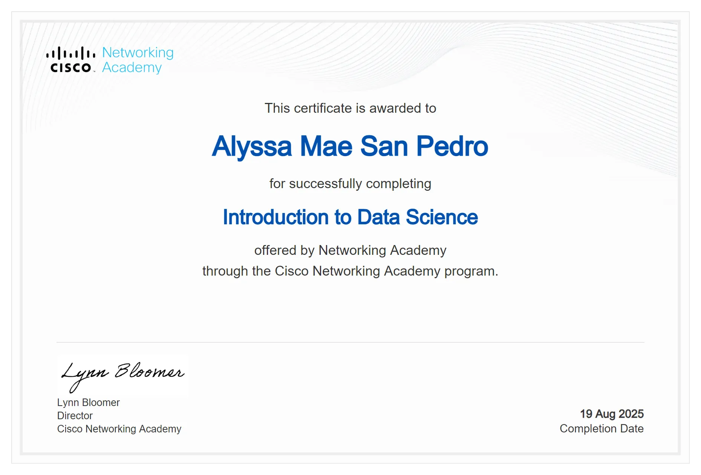</a> 
Introduction to Data Science
</td>
<td align="center" valign="top">
<a href="https://www.credly.com/badges/d33a0daf-263a-4c9c-9e06-83ba2814df16/public_url">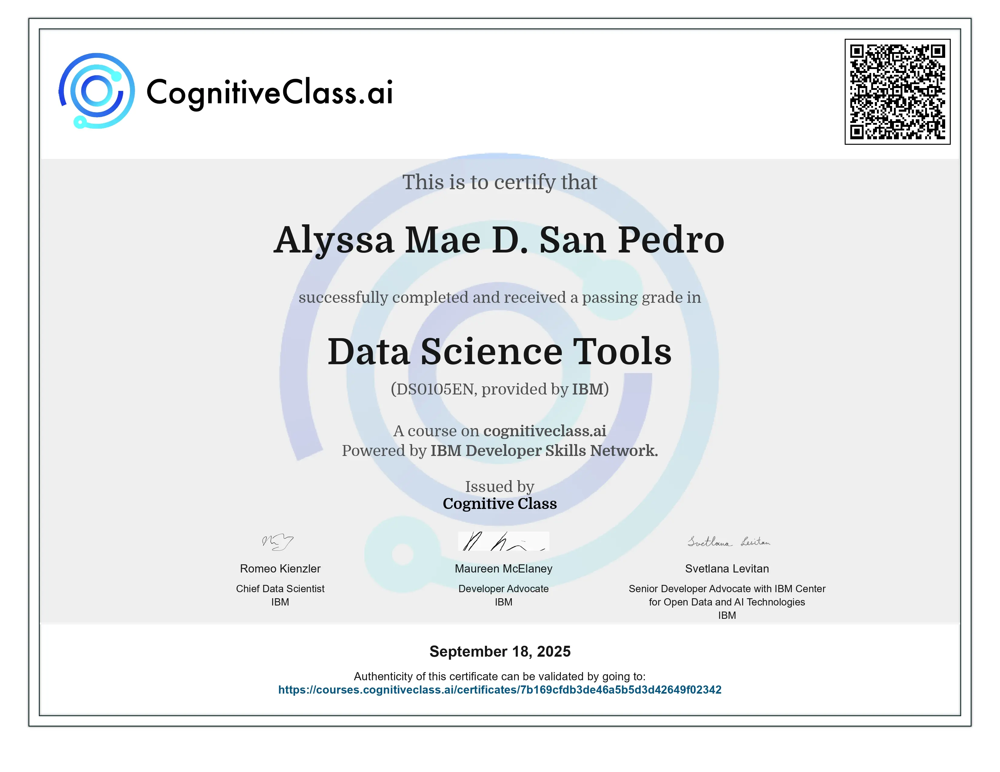</a> 
Data Science Tools
</td>
<td align="center" valign="top">
<a href="https://coursera.org/share/a50684b3356f97ae0d45357ebf331311">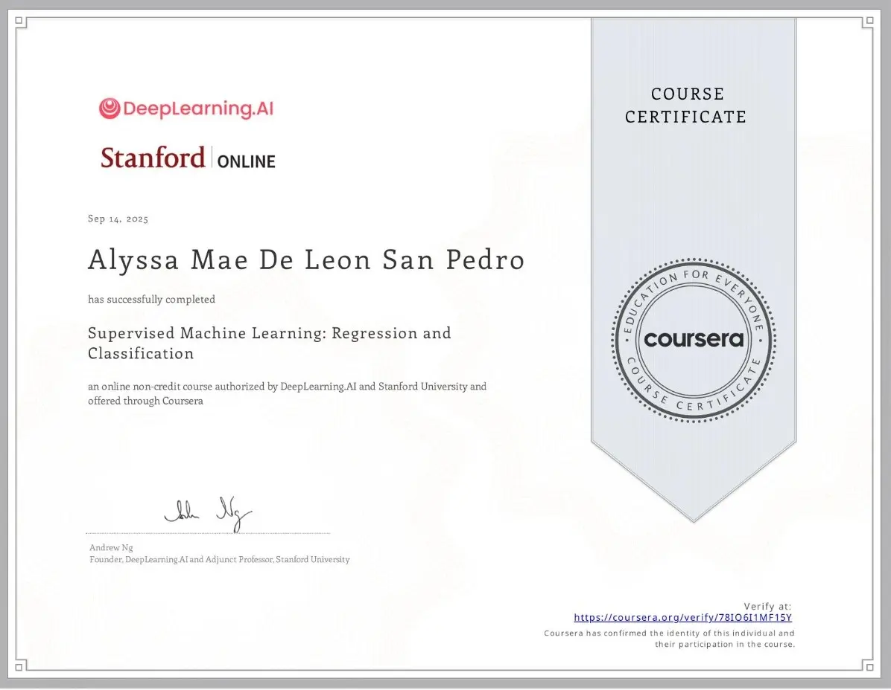</a> 
Supervised Machine Learning
</td>
<td align="center" valign="top">
<a href="https://courses.cognitiveclass.ai/certificates/6c4a083744344273b1bec5cfe546fd4c">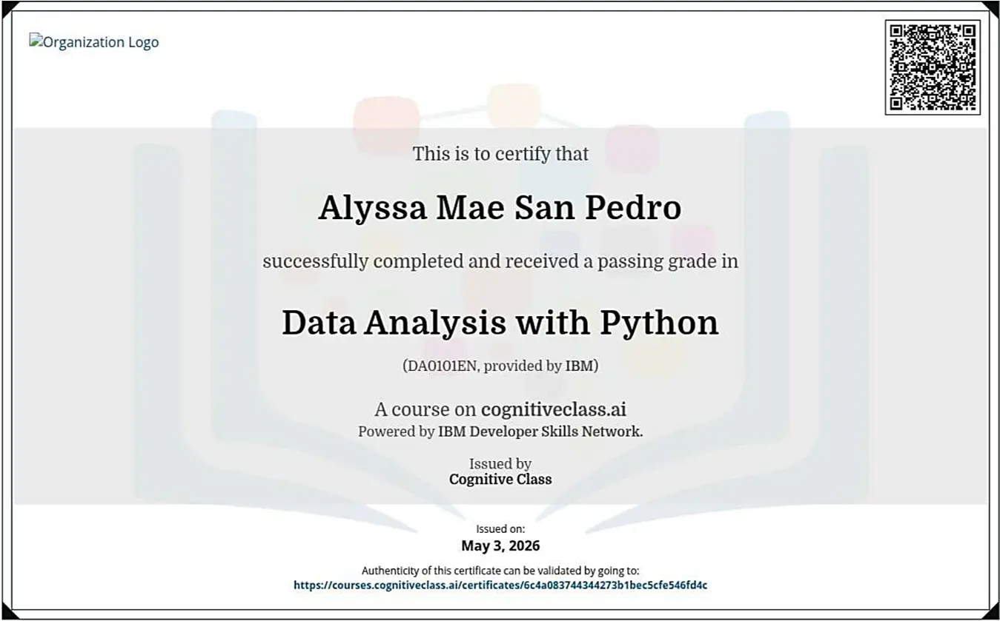</a> 
Data Analysis with Python
</td>
</tr>
<tr>
<td align="center" valign="top">
<a href="https://courses.cognitiveclass.ai/certificates/d43340bec83d4753ae35c2777bbd1ce1">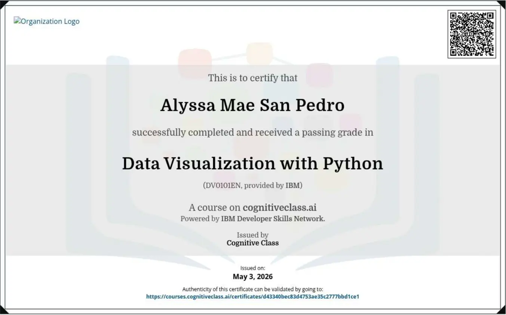</a> 
Data Visualization with Python
</td>
<td align="center" valign="top">
<a href="https://courses.cognitiveclass.ai/certificates/bb19468a08ed44cba94e53221fafc635">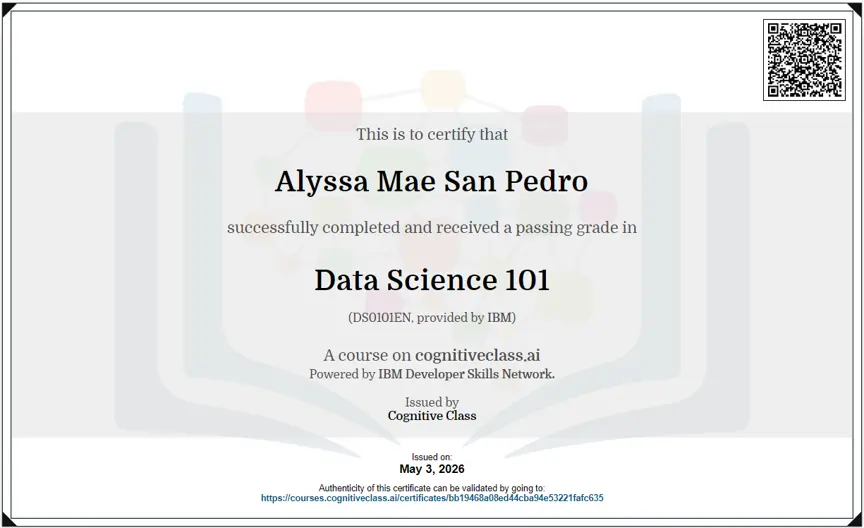</a> 
Data Science 101
</td>
<td align="center" valign="top">
<a href="https://cognitiveclass.ai/certificates/300b0be3-93d5-4078-9bdf-387351135a47">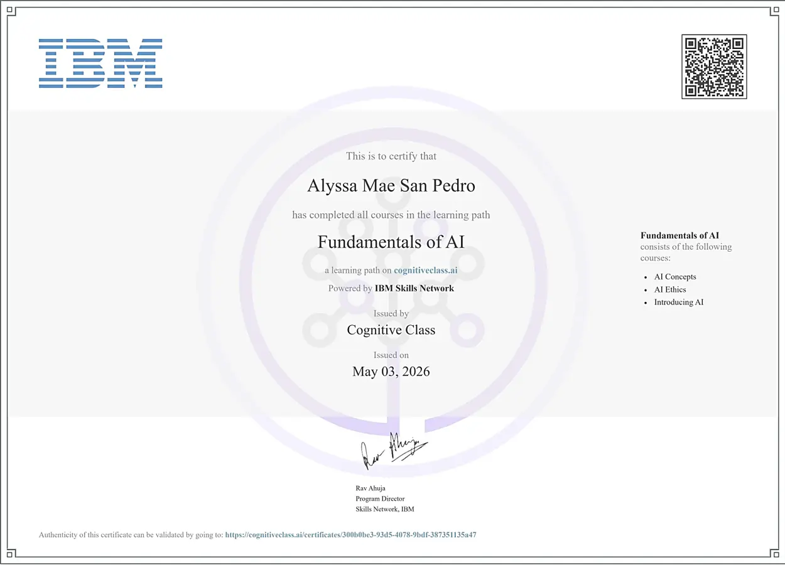</a> 
Fundamentals of AI
</td>
<td align="center" valign="top">
<a href="https://cognitiveclass.ai/certificates/315939ee-970b-4a21-a85e-82c9ddddcf8d">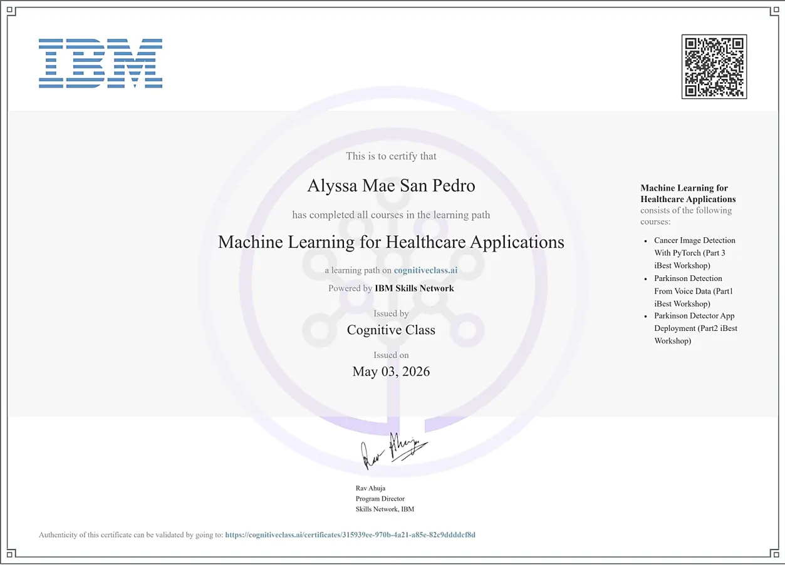</a> 
Machine Learning for Healthcare
</td>
<td align="center" valign="top">
<a href="https://www.credly.com/badges/7dcb7f3c-8378-4c79-bcfb-14617c52e693/public_url">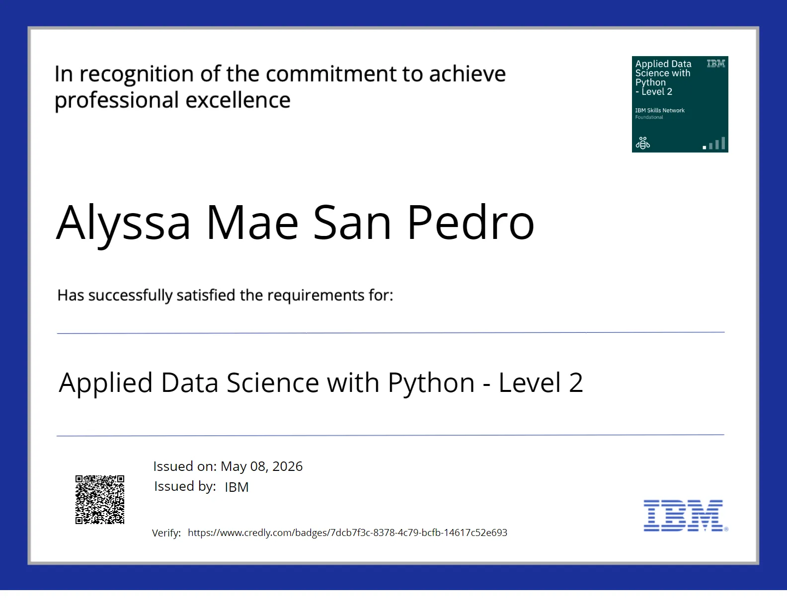</a> 
Applied Data Science with Python
</td>
</tr>
<tr>
<td align="center" valign="top">
<a href="https://www.credly.com/badges/f499b05e-986b-42ea-80f9-3afca5de26c7/public_url">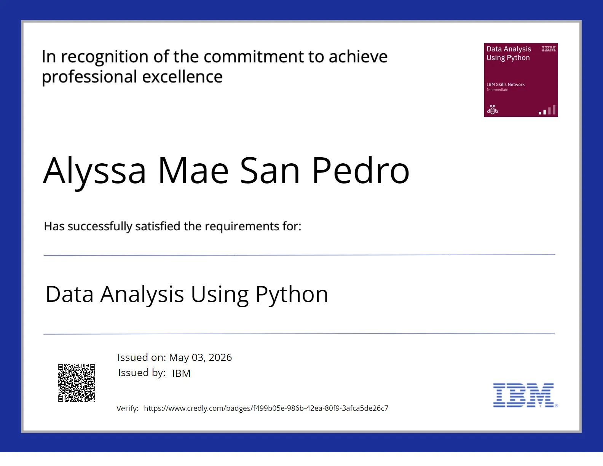</a> 
Data Analysis Using Python
</td>
<td align="center" valign="top">
<a href="https://www.coursera.org/verify/ZKNDNR7N4ZJY">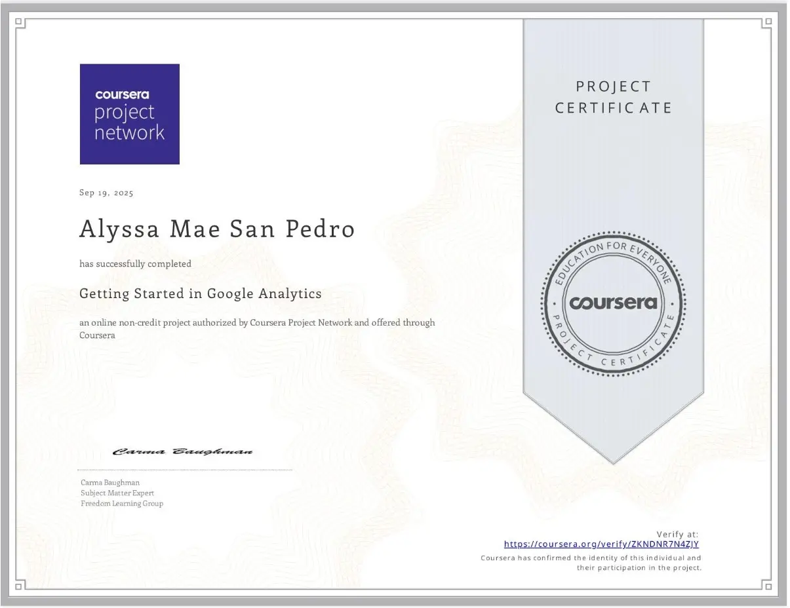</a> 
Getting Started in Google Analytics
</td>
<td align="center" valign="top">
<a href="https://www.coursera.org/verify/E103NF8AXCTR">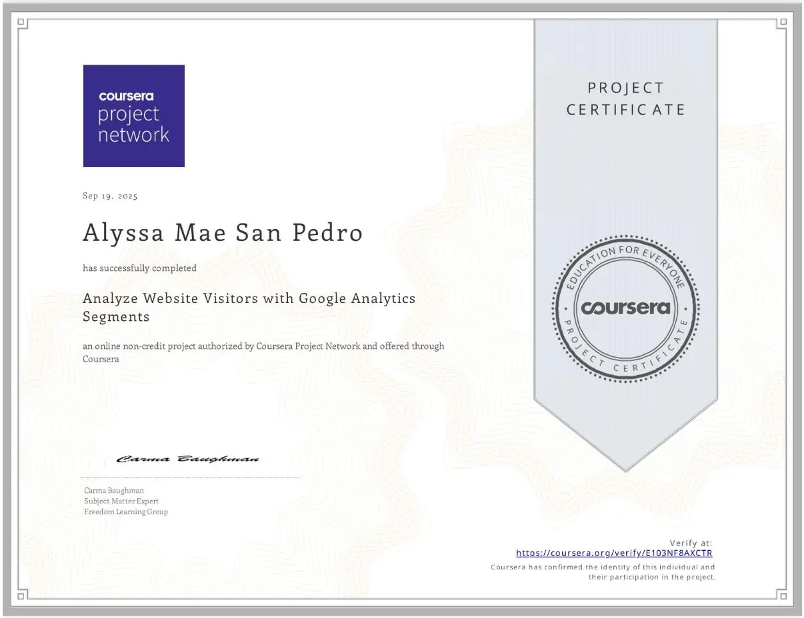</a> 
Google Analytics Segments
</td>
<td align="center" valign="top">
 
Introduction to Cybersecurity
</td>
<td align="center" valign="top">
<a href="https://www.credly.com/badges/43fccaf3-f9cf-4550-880b-16327fc8b504/public_url">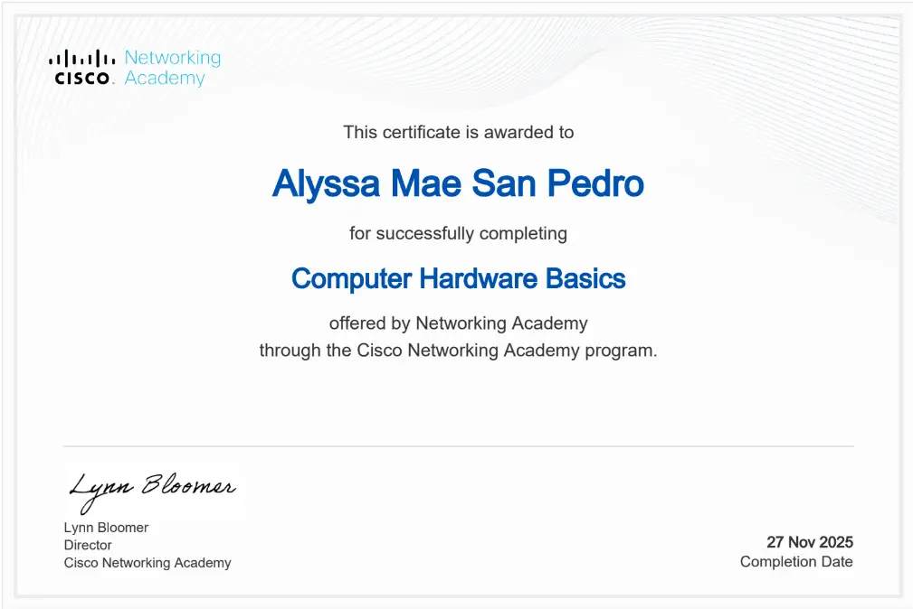</a> 
Computer Hardware Basics
</td>
</tr>
<tr>
<td align="center" valign="top">
<a href="https://www.credly.com/badges/340272ce-b2f6-41ce-ae29-c4d5310215be/public_url">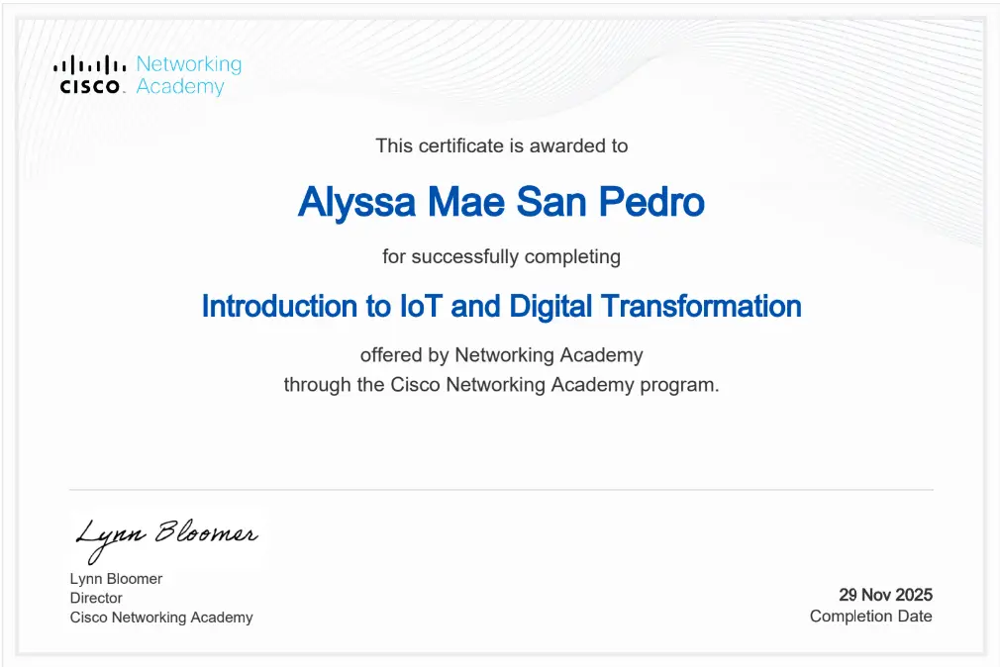</a> 
Introduction to IoT and Digital Transformation
</td>
<td align="center" valign="top">
 
Oracle AI Foundations
</td>
<td align="center" valign="top">
 
Oracle Data Management
</td>
<td align="center" valign="top">
 
Oracle OCI Foundations
</td>
<td></td>
</tr>
</table>

 

## 📊 GitHub stats

 

 

## 📫 Contact me

&nbsp;&nbsp;
&nbsp;&nbsp;

 

<a href="https://alyssamaesanpedro.github.io">alyssamaesanpedro.github.io</a>

  

<a href="https://github.com/alyssamaesanpedro">
<picture>
<source media="(prefers-color-scheme: light)" srcset="https://www.gitskins.com/api/section/heatmap?username=alyssamaesanpedro&theme=github-dark&avatar=https%3A%2F%2Favatars.githubusercontent.com%2Fu%2F163331805%3Fu%3D143af60cd2c0751cf718eb37273d3ca945597ae2%26v%3D4&variant=space-shooter&v=space-jet-original-2&mode=light" />

</picture>
</a>

